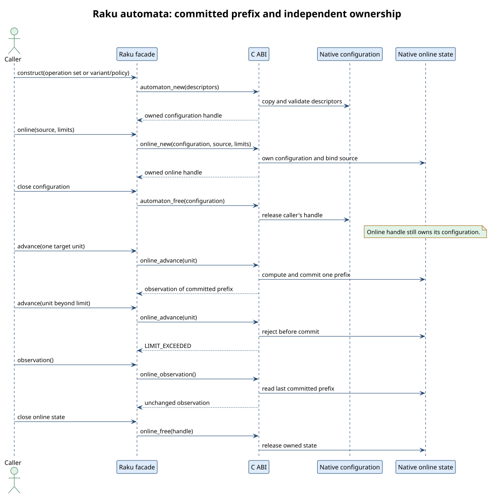

# Raku standalone automata boundary

The Raku facade delegates generalized and universal automata to the native C
ABI. This note connects the finite
[`RakuAutomataBoundary.tla`](tla/RakuAutomataBoundary.tla) model to public
Raku operations and executable tests. The native algorithms and their broader
contracts are documented in
[`standalone-automata.md`](../bindings/standalone-automata.md).



## Abstraction and refinement map

The model chooses a generalized operation or universal substitution scenario,
one of the three universal variants, a unit domain, and a target limit. It
then explores opening an online state, observing, advancing by a unit,
rejecting a step, and closing either handle in either order. The target has at
most two units. This is enough to expose the distinction between a generalized
empty intermediate row and a permanently dead universal frontier.

| Model value | Raku facade | Native ABI |
|---|---|---|
| `configuration` | `GeneralizedAutomaton` or `UniversalAutomaton` | owned configuration handle |
| `online` | `GeneralizedOnlineAutomaton` or `UniversalOnlineAutomaton` | separately owned mutable handle |
| `ownsConfiguration` | online handle stays usable after parent `.close` | native online state owns the configuration it needs |
| `prefix` | `observation.consumed-target-length` | committed target unit count |
| `accepted` | `observation.accepting` | accepted complete source at current target prefix |
| `rowNonempty` | `GeneralizedObservation.current-row-nonempty` | current generalized row only |
| `alive` | `UniversalObservation.alive` | canonical universal frontier liveness |
| `targetLimit` | `AutomatonLimits.max-target-units` | `LlevAutomatonLimits.max_target_units` |

`g_any`, `g_equal`, `g_equal_match`, and `g_listed` represent generalized
`ANY`, mismatched `EQUAL`, matching `EQUAL`, and `LISTED` operation
applicability. `g_listed_reverse` has the same target pair in
reverse order and must fail. `g_bridge` represents a zero-cost two-source,
two-target `EQUAL` operation. `u_directed` and `u_reverse` distinguish the
direction of a zero-cost universal equivalence. `u_plain` and
`u_plain_match` distinguish mismatch and identity under the unrestricted
specialization.
Universal variants agree for the one-unit model pairs; longer variant-specific
cases are checked against independent distance kernels in the existing
[`02-standalone-automata.rakutest`](../../bindings/raku/t/02-standalone-automata.rakutest).

The model uses abstract unit names. Its universal domain selection refines to
`Str`, `Blob`, or `Positional` at the Raku boundary. Generalized operations
require Unicode scalars. The Raku constructor validates the unit domain and
operation descriptors before publishing a handle; native construction copies
the descriptors. A failed online advance leaves `prefix` and all observations
at their last committed values. Closing the configuration leaves an open
online state usable because that state has independent native ownership.

## Invariant to property traceability

All invariants below are enabled in `RakuAutomataBoundary.cfg`. The executable
correspondence suite calls the public Raku facade through `NativeCall` into a
fresh native library. It enumerates finite source/target products for each
universal variant and bound, and checks every online prefix against complete
native evaluation.

| TLA+ invariant | Concrete property |
|---|---|
| `TypeOK` | Public constructors and raw layouts in `02-standalone-automata.rakutest`; invalid descriptors and units are rejected. |
| `RakuDomainPolicy` | Generalized `Str` typing and universal Unicode, byte, and u64 policy cases in both suites. |
| `PrefixBounded` | Every successful `advance` increments `consumed-target-length` by one; zero/one target ceilings reject excess units. |
| `PrefixObservation` | `03-automata-boundary-properties.rakutest` compares acceptance at every prefix with complete evaluation. |
| `RowObservation` | The two-unit generalized bridge has an empty first row and a nonempty second row. |
| `FrontierObservation` | A dead universal frontier cannot accept or revive on a later prefix. |
| `RejectedStepIsAtomic` | Both families retain target length and acceptance after limit or invalid-unit rejection. |
| `OwnedOnlineOutlivesConfiguration` | Both online families advance after the configuration is closed. |
| `ExactlyOneNativeFree` | Repeated `.close` remains harmless and `.opened` remains false for configurations and online states. |
| `NoUseAfterOnlineClose` | Closed online handles reject observation with `CLOSED`. |
| `DirectionalPolicy` | Forward generalized listed and universal equivalence pairs accept; reverse pairs reject in Unicode, byte, and u64 domains. |
| `GeneralizedReconnects` | The `EQUAL(2,2)` bridge accepts at target prefix `ab` after the empty row at `a`. |
| `UniversalDeadCannotAccept` | Every dead observation in the finite variant product is nonaccepting. |

The C ABI does not promise concurrent use of one mutable online handle. The
facade documents it as exclusive, while immutable configurations can be
shared. The model represents sequential calls on one handle; concurrent
ownership and data-race freedom belong to the native ABI contract and its
separate tests.

## Reproduce

Run the finite model under a 2 GiB memory cap:

```sh
systemd-run --user --scope -p MemoryMax=2G -p CPUQuota=100% \
  java -Xmx1G -jar "$HOME/.tla/tla2tools.jar" -workers 1 \
  -config docs/verification/tla/RakuAutomataBoundary.cfg \
  docs/verification/tla/RakuAutomataBoundary.tla
```

On 2026-10-12 TLC 2.20 completed with **10,800 generated states, 3,618 distinct
states, and no invariant violation**. There are no skipped invariants or
admitted obligations in this model. The repository's formal gate also discovers
the `.cfg` automatically with `scripts/verify-formal.sh tla`.

Build the native library and run both Raku suites with the Raku interop module
on the import path:

```sh
CARGO_BUILD_JOBS=1 CARGO_INCREMENTAL=0 cargo build --locked --features ffi
export LIBLEVENSHTEIN_LIBRARY="$PWD/target/debug/libliblevenshtein.so"
raku -Ibindings/raku/lib -I../vinary-tree-interop/bindings/raku/lib \
  bindings/raku/t/02-standalone-automata.rakutest
raku -Ibindings/raku/lib -I../vinary-tree-interop/bindings/raku/lib \
  bindings/raku/t/03-automata-boundary-properties.rakutest
```

The finite model does not prove arbitrary-length edit-distance completeness or
the internals of the native Rust transition kernels. The Rust generalized and
universal verification work and native-versus-binding differential tests cover
those separate obligations. A source-level audit of the Raku facade and docs
is still an independent review step for the release task.
